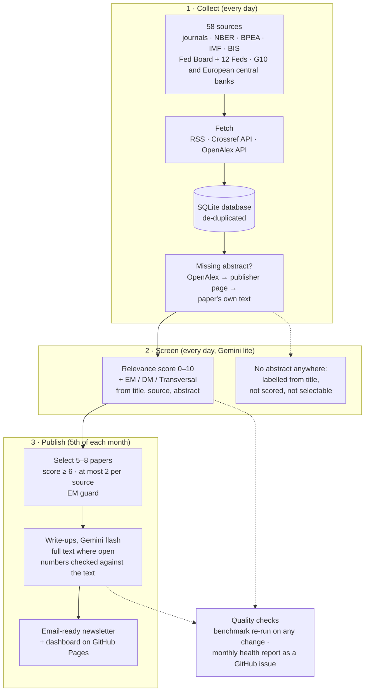

# The Research Roundup

An automated Python agent that monitors new economics research from leading
journals, central banks and research institutions, and produces a monthly
email-ready HTML newsletter of 5–8 curated papers, each with a summary, key
takeaways, why it matters for markets, and an EM / DM / Transversal
classification with its rationale.

**Live links**

- Interactive dashboard: <https://tsaichingjou.github.io/research-roundup/>
- Latest newsletter (October 2026): <https://tsaichingjou.github.io/research-roundup/issues/2026-10.html>
  (every issue is at `issues/YYYY-MM.html`, and the dashboard links to each)
- How the scores, labels and selection work: <https://tsaichingjou.github.io/research-roundup/#method>

Full design notes, source by source, are in **[TECHNICAL.md](TECHNICAL.md)**.

## How it works



Everything runs on GitHub Actions with no server: screening every day, the
issue on the 5th (each issue covers one calendar month), and a catch-up that
remakes an issue that GitHub delayed or skipped.

## Highlights

- **Every source in the brief, 58 in all**: the five top journals, NBER, BPEA,
  the IMF and the BIS, the Federal Reserve Board and the 12 regional Feds, the
  G10 central banks and the ECB, and 25 European national central banks. They
  are read through stable, documented channels rather than scraping: RSS feeds
  (NBER, BIS, the Feds via Fed in Print), the Crossref API (journals and the IMF,
  by ISSN) and the OpenAlex API (central banks by institution, BPEA, and missing
  abstracts).
- **Google Gemini, two models for two jobs**: a fast, cheap model
  (`gemini-3.5-flash-lite`) scores and classifies every paper; a stronger one
  (`gemini-3.6-flash`) writes up only the 5–8 selected papers. Each falls back
  to another model when overloaded, every output records which model made it,
  and a month runs inside the free tier.
- **Scored and classified from the abstract**: each paper gets a relevance
  score (0–10) and an EM / DM / Transversal label from its title, source and
  abstract. Where the source gives no abstract, one is looked for in three
  places (OpenAlex, the publisher's page, the opening of the paper's own text).
  Papers with none anywhere are labelled from their title only, are not scored,
  and can never be among the papers chosen for the newsletter.
- **Write-ups from the full text**: the selected papers are written up from
  their open PDF or web page where one exists, so the key takeaways quote actual
  estimates; otherwise from the abstract, and each entry says which.
- **Classification checked, not assumed**: two independent models agree on
  96% of a stratified sample of 105 papers (Cohen's κ 0.94, EM 35/35); the
  disagreements are listed for human review ([details](TECHNICAL.md#evaluating-the-classification)).
- **LLM quality kept up over time, automatically**: a frozen benchmark is
  re-run whenever the prompt or the models change, every number in a write-up
  is checked against the paper's text, and each issue gets a health report in
  English, posted as a GitHub issue that GitHub emails to the owner ([details](TECHNICAL.md#keeping-llm-quality-up)).
- **Runs itself**: GitHub Actions fetches and scores new papers every day and
  publishes the issue on the 5th, with a catch-up that remakes an issue missed
  or delayed by GitHub, or written while the preferred model was overloaded.
- **A calendar month per issue, nothing lost**: the October issue covers
  1–31 October and closes on 5 November, so papers indexed a few days late make
  their own month; anything later joins the next issue as a late arrival.
- **Honest about gaps**: JPE is only partly covered (no open abstracts) and BPEA
  has returned no papers so far; both are documented in the
  [technical notes](TECHNICAL.md#source-coverage), as are the limits of the
  agreement check.
- **A dashboard for readers without context**: the newsletter, every paper
  of each period with filters, source coverage by market focus, and a "How it
  works" page explaining the scores, labels and rules.

## Run it

**On your own machine** (Python 3.11+, a free [Gemini API key](https://aistudio.google.com/apikey)):

```bash
git clone https://github.com/tsaichingjou/research-roundup.git
cd research-roundup
python -m venv .venv && source .venv/bin/activate   # Windows: .venv\Scripts\activate
pip install -r requirements.txt
cp .env.example .env               # paste the Gemini API key into .env
python main.py fetch               # ~700 papers from the 58 sources, a few minutes
python main.py publish             # score, select, write up last month's issue, build the site
open site/index.html               # the dashboard (Windows: start site\index.html)
```

A first run makes roughly 70–90 Gemini calls, within the free tier.
`python -m pytest -q` runs the 81 tests without network access or API keys.

**Deployed, as here** (GitHub Actions + GitHub Pages): fork the repository, add
the secret `GEMINI_API_KEY` under *Settings → Secrets and variables → Actions*,
set *Settings → Pages → Source* to *GitHub Actions*, and start the *Research
Roundup pipeline* workflow once from the Actions tab. After that it runs on its
own. Schedules, run modes and every command are in
[TECHNICAL.md](TECHNICAL.md#deployment-and-scheduling).

## Key design decisions

- **Documented APIs and feeds, not scraping**, so the agent keeps working when
  sites change; the price is two gaps, JPE (no open abstracts) and BPEA (not
  yet in OpenAlex), both [documented](TECHNICAL.md#source-coverage).
- **A cheap model for every paper, a stronger one for the few that matter**:
  scoring ~700 papers a month and writing 5–8 careful summaries stays within
  Gemini's free tier.
- **Abstracts for scoring, full text for writing**: the brief's rule (titles and
  abstracts) decides what is chosen; the write-ups read the open full text so
  the takeaways can quote actual estimates.
- **Fallbacks per paper, not per source**: a source is not dropped because some
  of its feed lacks abstracts; [the table](TECHNICAL.md#source-coverage) shows
  which sources needed which fallback.
- **Rules a reader can check**: selection thresholds, the scoring scale and the
  market-focus definitions are in config files and on the dashboard's "How it
  works" page, not hidden in code.

## Repository map

| Path | What it holds |
|---|---|
| `main.py` | Command-line entry point: `fetch`, `screen`, `publish`, `build` and the evaluation commands |
| `src/` | The agent: `fetchers/` (RSS, Crossref, OpenAlex), `enrich.py` and `fulltext.py` (abstracts and full text), `analysis.py` (scoring, selection, write-ups), `quality.py` (LLM quality checks), `site.py` (newsletter and dashboard) |
| `config/` | Sources, central banks, models, selection rules and site settings |
| `templates/` | Newsletter and dashboard design |
| `docs/` | The built website, as published on GitHub Pages |
| `data/published.db` | The database behind the live site |
| `evaluation/` | Classification agreement report, benchmark and monthly quality reports |
| `.github/workflows/` | Daily and monthly runs, regression check, tests |
| `tests/` | 81 automated tests |
